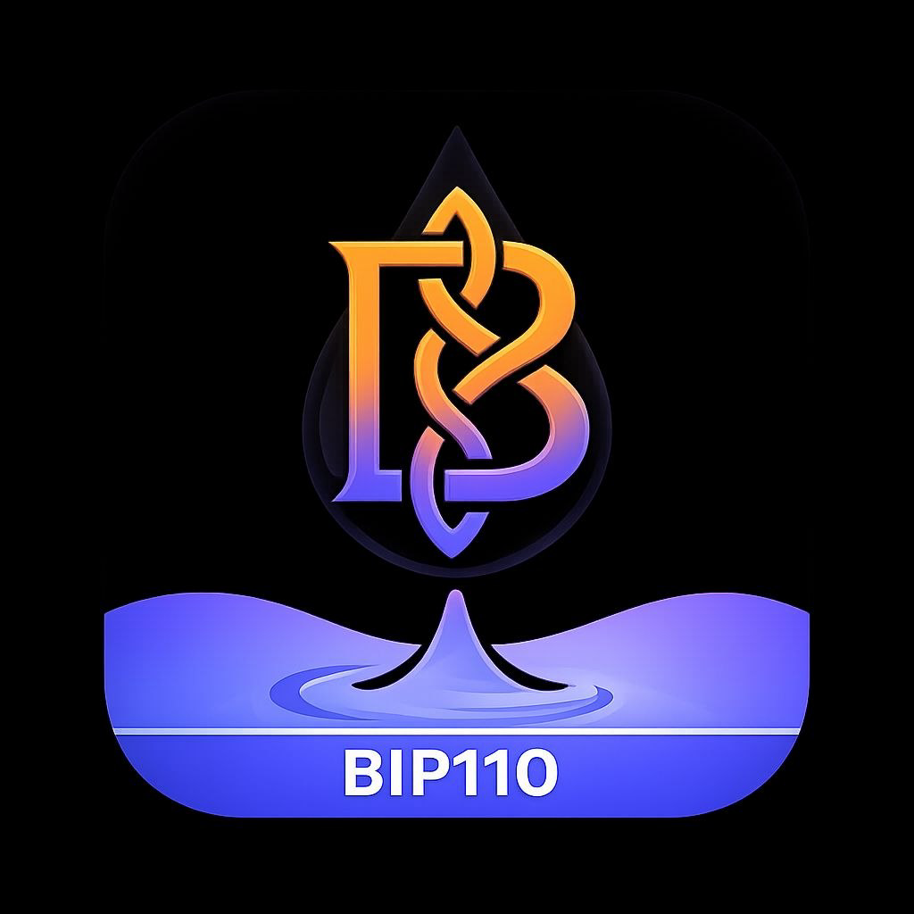

<p align="center"></p>

# Mempool for Bitcoin (BLAKE2b)

A self-hostable mempool explorer for **Bitcoin (BLAKE2b)**, the chain that moved its proof of work to BLAKE2b at block **961640**. It's what runs at **[mempool.kilombino.com](https://mempool.kilombino.com)**.

Blocks, transactions, fees, mining and Lightning work the same way as on the explorer you already know, adapted to this chain:

- **BLAKE2b blocks:** 164-byte headers, the activation headline, this chain's block weight (800k WU), and difficulty and hashrate charts that start at the activation block.
- **Who mines each block:** our own `pools-v2.json` (TerminusPool, RouteHash, AlphaPool, the PyBLOCK services, DATUM solo miners…). An hourly autotagger and your pull requests keep it up to date, and DATUM blocks without a name are grouped as "Unnamed DATUM".
- **Replay protection:** the unified sighash (`0x20` bit) is recognised and flagged. On a transaction page you can see whether it was replayed to or from the Spamchain and which of its outputs were already spent there.
- **Coinjoins:** Kilojoin rounds (equal outputs, every input signed with the unified sighash) are detected and flagged.
- **Bitcoin Nodes World Map:** an hourly registry of the BLAKE2b nodes our node finds, shown on a world map in the dashboard and at [/nodes-map/](https://mempool.kilombino.com/nodes-map/). The code is in `contrib/nodes-map`.
- **My Bitcoin Peers:** the explorer's own node's peers, by client version and by network (IPv4, IPv6, Tor, I2P, CJDNS).
- **Lightning on BLAKE2b:** network map, the [Nodex](https://nodex.kilombino.com) explorer, a node directory where operators publish their own card by signing with their node, and Lightning2Lightning reputation badges.
- **Price widget** (`/api/v1/blake2b/…`): price in 35 currencies, the Poolsats rate, network hashrate, and current, previous and expected next difficulty.

## Install

### StartOS

In **Marketplace → Change registry**, add `https://registry.kilombino.com` and install **Mempool Kilombino**. You need a Bitcoin (BLAKE2b) node, e.g. Knots BLAKE2b from Paul's registry, `https://start9.paulscode.com`.

### Umbrel

Add the community app store `https://github.com/Kilombino/umbrel-store` and install **kilombino-mempool**. It uses your Bitcoin (BLAKE2b) node and an Electrs that understands BLAKE2b headers.

### Docker (self-host)

```sh
sh docker/init.sh        # copies the Dockerfiles into backend/ and frontend/ and downloads GeoIP data

# Backend: Rust GBT + Node. The named build contexts are required.
docker buildx build --tag mempool-bip110-backend:local \
  --build-context rustgbt=./rust --build-context backend=./backend \
  --build-arg commitHash=$(git rev-parse --short HEAD) --load ./backend/

# Frontend (Angular)
docker buildx build --tag mempool-bip110-frontend:local \
  --build-arg commitHash=$(git rev-parse --short HEAD) --load ./frontend/
```

Then use `docker/docker-compose.yml` as a starting point. `docker/README.md` lists every option. To update: `git pull`, rebuild both images and `docker compose up -d`.

## What it needs

- **A Bitcoin (BLAKE2b) node** (Knots BLAKE2b) with `txindex=1`. Blocks arrive slowly on this chain, so the node can stay in "initial block download" for a long time. Raise `maxtipage` so wallets and the explorer don't treat it as out of sync. The node must allow RPC from the Docker subnet (`rpcallowip=172.16.0.0/12`).
- **An Electrum server that understands 164-byte headers**, for address search and history. A stock Fulcrum or electrs stops at block 961639. Use a BLAKE2b build, such as the privkeyio Fulcrum (what mempool.kilombino.com uses), Shulcrum (`Kilombino/Fulcrum`, branch `blake2b-headers`) or Paul's electrs, with `MEMPOOL_BACKEND=electrum`.
- **MariaDB**. The `blocks.header` column is widened to `varchar(500)` by a migration, because BLAKE2b headers don't fit the original 160 characters.

Settings that matter on this chain:

| Variable | Value | Why |
|---|---|---|
| `MEMPOOL_BLOCK_WEIGHT_UNITS` / `BLOCK_WEIGHT_UNITS` | `800000` | this chain's block weight (backend / frontend) |
| `MEMPOOL_AUTOMATIC_POOLS_UPDATE` | `true` | picks up new miners from `pools-v2.json` |
| `MEMPOOL_POOLS_JSON_TREE_URL` | `https://api.github.com/repos/Kilombino/mempool-bip110/git/trees/main` | the miner list lives in this repo |
| `MEMPOOL_POOLS_UPDATE_DELAY` | `3600` | check hourly instead of weekly; newly tagged blocks are re-attributed |
| `SPAMCHAIN_RPC_URL`, `SPAMCHAIN_ELECTRUM_*`, `SPAMCHAIN_EXPLORER_URL` | optional | a Spamchain node, for the replay information on transaction pages |
| `NODES_MAP_UPSTREAM` | optional | routes `/nodes-map` to the `contrib/nodes-map` container |

## Adding a miner

Mining a block and showing up as "Unknown"? Open a pull request that adds your entry to `pools-v2.json` with its payout addresses and/or a coinbase tag, and a logo at `frontend/src/resources/mining-pools/<slug>.svg`. That directory is gitignored, so use `git add -f`. Keep the file on one line, as it is now.

`scripts/blake2b-unknown-tags.py` lists coinbases since block 961640 that the list doesn't name yet, using the backend's own matching rules: payout addresses first, then case-insensitive regex tags.

```sh
python3 scripts/blake2b-unknown-tags.py                # against mempool.guide's public API
python3 scripts/blake2b-unknown-tags.py --api http://127.0.0.1:8999/api/v1 --pools pools-v2.json
```

It prints one line per unmatched identity (block count, first height, coinbase tag, payout address). It also prints one line per entry that matched by address while the coinbase carries a different tag, which usually means the entry has a placeholder name. Blocks are cached in `~/.cache/blake2b-unknown-tags.json`, so a cron run fetches only new blocks. `--quiet` prints nothing when the list is complete. It uses only the standard library.

## Credits & license

Built on [mempool/mempool](https://github.com/mempool/mempool), through [Retropex/mempool](https://github.com/Retropex/mempool) and [paulscode/mempool-bip110](https://github.com/paulscode/mempool-bip110). Thanks to everyone who sent miners and logos.

Licensed under **AGPL-3.0** (see `LICENSE`). This is an independent project, not affiliated with The Mempool Open Source Project®.

Contact: [X](https://x.com/Kilombino_) · [Telegram](https://t.me/kilombino) · [GitHub](https://github.com/Kilombino) · kilombino@proton.me
